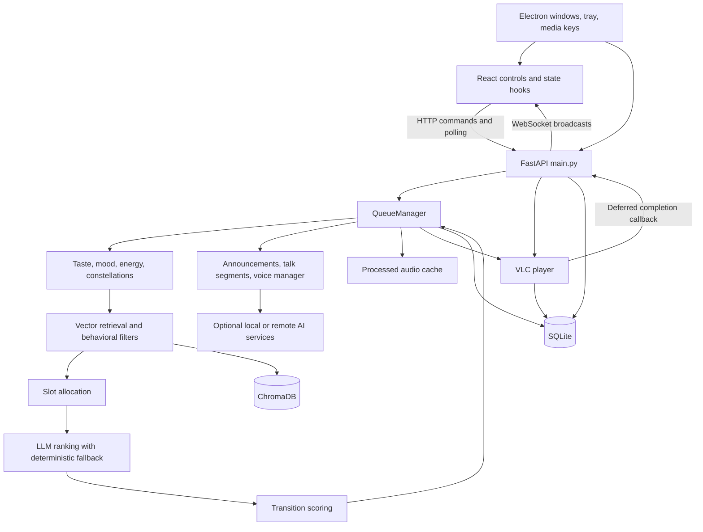

# Radio architecture

## Scope and evidence

This is the initial static architecture baseline, inspected on October 26, 2026 at commit `63cc57562baa85645211fa120f42d78d0a67f8ac`. It describes existing code, not a claim that runtime behavior has passed validation. See [BASELINE.md](BASELINE.md) for limitations and identified defects. Source line numbers in that document refer to the baseline commit.

The modernization branch is `codex/stability-server-architecture`; the rollback reference is `codex/modernization-baseline-20261026`. Git does not protect the ignored runtime data, original audio, or source JSON metadata.

## Existing system

The backend owns audio output. The frontend sends commands and displays backend state; it does not currently own music decoding or output. Queue construction, physical playback, and feedback persistence cross module boundaries in both directions.

## Startup and shutdown

`frontend/package.json` starts Vite and Electron together. Electron's `startBackend()` in `frontend/electron/main.cjs` spawns `backend/main.py`, preferring the project virtual environment. The current launcher falls back to a system Python if the virtual environment is missing; development and verification must use the project virtual environment explicitly.

`backend/config.py` loads the root `.env`, defines original-data and generated-cache paths, and establishes model/provider defaults. FastAPI's lifespan initializes/migrates SQLite, closes stale listening sessions, prunes old mood repulsion, adjusts settings, and starts configured managed processes. It also performs a background Chroma health check, cleans generated effect/separator/TTS caches, initializes VLC and the queue/mood singletons, installs completion callbacks, starts a preview rebuild, probes TTS, and starts the WebSocket broadcast worker.

Startup therefore mutates persistent state and caches. Starting the normal application is not a safe read-only baseline check.

The lifespan shutdown stops managed external processes, cancels the broadcast worker, and stops VLC. The original implementation does not join queue workers or await the cancelled broadcast task. Electron sends `/api/shutdown` and immediately attempts a process-tree kill; the graceful request is not awaited. These paths need explicit lifecycle tests before changing ownership.

## Storage and identifiers

| Resource | Location and owner | Safety boundary |
| --- | --- | --- |
| Original music | `audio_files/`; scanned by ingest, read by VLC | Irreplaceable originals; never write, move, or delete during this work |
| Primary descriptive metadata | `docs/understand/` JSON; ingest metadata loader | Read-only originals; metadata writer can intentionally modify these in normal app use |
| Library, history, settings | `data/radio.db`; `db/database.py` | No automated tests against this database |
| Text/audio vectors | `data/chroma/`; shared `db/chroma.py` singleton | No regeneration, reset, or write-producing compatibility probe |
| Speech and effects | `data/tts_cache/`, `data/dj_effect_cache/` | Generated resources; currently subject to startup/age cleanup |
| Artwork, alignment, separated vocals | `data/art/`, `data/lyrics_timing/`, separator directories | Preserve originals and existing derived data; isolate test output |
| Model files and logs | configured paths, `data/logs/` | Do not change model installations or unrelated configuration |

SQLite song IDs identify library rows. Paths locate physical media; scanner deduplication uses a path hash. Chroma collections use string song IDs. The `songs` and configured `songs_audio` collections hold distinct embedding spaces. SQLite connections enable WAL, foreign keys, and a busy timeout. `database.py` originally captures `config.DB_PATH` at import, a significant test-isolation concern.

`db/chroma.py` lazily constructs a persistent singleton and can create directories/collections. Opening it is not equivalent to a filesystem-only inspection. Counts in `AGENTS.md` are reference values, not a fresh inventory.

## Recommendation and queue flow

`engine/taste.py` maintains multiple timescales of taste. `retriever.py` combines text/audio vector candidates with mood, vibe lock, recency, blacklist, and feedback filtering. `slots.py`, `reranker.py`, and `transitions.py` allocate and rank candidates. `constellations.py` adds taste-pocket context. QueueManager coordinates these modules and has deterministic/single-song fallback paths; the ranking algorithm should remain unchanged during extraction.

QueueManager holds AI, manual, preview, and pending-talk queues, current song/session, memory, mood, recently recommended IDs, generation counters, speech/effect caches, and background worker events. `pop_next()` prioritizes pending talk, then manual songs, then AI songs; it waits on a condition for rebuild work and falls back outside the condition. Consuming a recommendation records queue history. That is distinct from actual playback history.

`on_song_started()` updates context, swaps or clears preview state, and schedules a rebuild. Rebuilds take a playback-context snapshot and perform expensive ranking and speech work before publishing results. Generations attempt to reject stale work. The preview watchdog and TTS checker can independently schedule or refresh work; cancellation, generation ownership, and consistent locking need regression coverage.

## Playback and feedback

`engine/player.py` wraps VLC media-list playback. `play_song()` starts a song and `play_chain()` chains speech/song resources. VLC callbacks track chain position and distinguish speech from songs. Generation and explicit-stop flags attempt to suppress stale callbacks. Completion dispatch moves application callbacks to background threads so subsequent VLC commands do not run directly inside VLC's event thread.

The player writes a completed play event. The callback registered in `main.py` updates queue/derived completion state, records energy, emits an event, consumes the next queue item, records a playing event, starts playback, and schedules the next rebuild. API playback routes also write history and invoke QueueManager. There is no single authoritative playback-instance event processor across these paths.

QueueManager still calls the global player directly, even though its constructor accepts a player. Sleep timer and Electron controls also target the shared desktop playback state. Browser session independence cannot be achieved by changing only the frontend.

## Speech, effects, and external services

`announcer/announcements.py` generates short DJ lines; `talk_segments.py` schedules longer segments and persona behavior. `voice_manager.py` coordinates OmniVoice and Piper, generated WAV processing, caching, and voice selection. QueueManager prepares speech ahead of use and can play speech-only chains. Speech must not become song listening history.

`engine/dj_effects.py` generates cached processed media; VLC additionally owns playback-specific gain/EQ behavior. Generated files currently have paths rather than a complete streamable-resource ownership contract. Browser support needs resource IDs and retention while preloaded, playing, or reconnectable, before exposing cleanup-managed files through HTTP.

`llm/registry.py` selects cached chat/embed providers and fallback behavior. Ollama and OpenAI-compatible implementations provide separate chat/embed interfaces. MuQ and OmniVoice are optional inference engines. `engine/process_manager.py` owns configured subprocess launch, health checks, log capture, and shutdown. Missing optional services must remain recoverable without blocking basic library playback.

## HTTP, WebSocket, and frontend

`frontend/src/api/index.js` centralizes HTTP commands. At baseline its non-localhost branch points back to the viewer's localhost and WebSocket uses a fixed localhost URL. React state hooks combine polling with WebSocket events. Electron tray/widget/mini-player routes likewise assume a local shared backend.

`main.py` hands cross-thread events to an asyncio queue using `run_coroutine_threadsafe`. A broadcast worker serializes outgoing writes and removes failed clients. The same write lock covers direct replies. Events are broadcast to connected clients without playback-session scoping; they are notifications, not a durable replay log. Recovery must be based on authoritative snapshots and revisions.

The baseline server binds to all interfaces when started as a script. CORS permits development origins, but CORS does not authenticate requests. Remote access requires an explicit authentication and origin policy for HTTP, WebSocket, and media requests.

## Concurrency boundaries

Concurrent actors include FastAPI handlers, VLC callback threads, deferred completion callbacks, recommendation rebuilds, preview/TTS workers, ingest jobs, model operations, managed-process monitoring, and the asyncio broadcast worker. Shared state is protected by several different locks, including player, callback, queue condition, preview, speech cache, and singleton locks. Lock coverage is not uniform. Expensive operations and native callbacks make lock order and bounded shutdown particularly important.

## Agreed target boundaries

The user selected **shared taste/history with independent playback sessions** and **explicit playback-mode transfer of the current song and position**. Shared history does not imply shared queues or permission for a browser to interrupt another device.

| Component | Intended authority |
| --- | --- |
| Recommendation service | Existing retrieval/ranking semantics; no physical audio output |
| Queue/session service | Session-specific queue, reservations, revision, current logical media |
| Playback coordinator | Playback instance, device ownership, state transitions, idempotent feedback |
| VLC adapter | Existing server audio transport and native callbacks |
| Browser client | Local media output and observed playback events |
| Media service | Authorized stable-ID streams, validated paths/ranges, generated-resource lifetime |
| Shared persistence | Library, taste inputs, history, settings, embeddings |
| HTTP/WebSocket boundary | Authenticated commands/events and recoverable session snapshots |

These are in-process responsibilities, not a requirement for microservices. Preserve legacy API compatibility and default VLC behavior. Transfer must explicitly retire the old playback instance, preserve the selected track/position, and prevent stale completion from advancing either session. Browser feature parity remains unproven until speech, effects, transitions, normalization, controls, sleep timers, and Electron behavior are tested.
