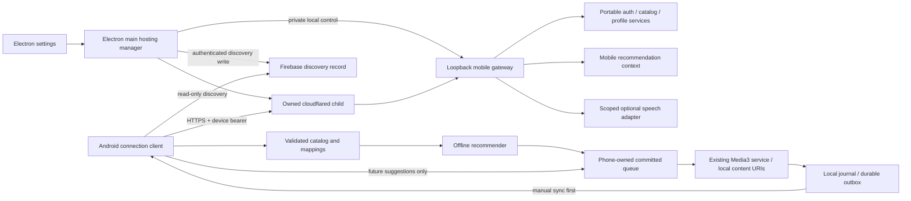

# Mobile connection architecture and Phase 0 audit

Date: October 30, 2026. Audited source: `a6715a8813aaf658f379cd156918168b8b0c8d8e`, branch `android-app`.
The working tree was clean at the start. The Phase 0 checkpoint changed documentation and added one exact `.gitignore` exception so this plan could be tracked; it made no production code changes. The sections below record that audit and its proposals; current implementation updates are linked next.

Implementation update, November 4, 2026: checkpoints through 2B are accepted and merged into main. Checkpoints 2C manual sync and 3A secure remote hosting are implemented, verified and phone-accepted. Checkpoint 3B automatic discovery is also phone-accepted as of November 4, 2026, on `codex/android-3b-discovery`, preserving the uncommitted accepted changes. Implementation and verification are recorded in [ANDROID_APP_PLAN.md](ANDROID_APP_PLAN.md). [MOBILE_PAIRING.md](MOBILE_PAIRING.md) covers setup and [MOBILE_SYNC.md](MOBILE_SYNC.md) covers manual sync. The matrix below remains the historical Phase 0 baseline. Checkpoint 4 and later remain proposals.

## 1. Scope and decisions from the user

- October 31 clarification: keep the implementation sized for one personal server and roughly two users. Prefer explicit preparation/import and existing stores; do not add account management, distributed workers or scaling infrastructure without a demonstrated need.
- The existing local-player milestone has been phone-tested and accepted. Do not request that acceptance again. New integration changes still require regression checks and their own phone review.
- Android remains the playback owner through its existing Media3 service. Desktop and phone have independent active queues, positions, mood, timers and DJ contexts.
- Phone recordings are the same audio as on the laptop, but some names differ. Most follow an artist/title pattern with extra suffixes. This does **not** establish byte-for-byte equality; renamed copies should match by content hash, while retagged/re-encoded copies may need review.
- Direct LAN hosting is deferred. Use USB/`adb reverse` for development and HTTPS through Cloudflare Quick Tunnel for the first remote release. No LAN listener, firewall opening or insecure-LAN opt-in is needed for these checkpoints.
- Firebase Spark is for endpoint discovery only. No music, Radio bearer tokens, listening history or model hosting belongs there. No domain, VPS, VPN, billing activation or permanent tunnel service is required.
- Complete one agreed checkpoint, provide evidence and acceptance steps, then stop for approval. This document does not authorize implementation or external account setup.

## 2. Historical Phase 0 implementation matrix (October 30)

| Area | Actual state | Source evidence and missing work |
| --- | --- | --- |
| Android local library | Integrated, accepted local-player baseline | `music/LocalMusicScanner.kt`, `data/LibraryRepository.kt`: recursive SAF reads, opaque document IDs, transactional scans and availability. No source-audio writes. |
| Local playback and queues | Integrated | `playback/RadioPlaybackService.kt`, `LocalPlaybackController.kt`: one service player, snapshot queues, shuffle/repeat, notification controls, paused bookmarks, sleep timer and attenuation-only normalization. |
| Android network transport | Absent | Main manifest has foreground-service and wake-lock permissions but no `INTERNET`; Gradle has no HTTP/Firebase client dependency. |
| Native device provisioning | Server primitive only | `portable_api.py`, `portable_sync.py`: admin token issue/revoke, digest storage, scopes and one-year default expiry. No pairing tickets, device-list UI, renewal/recovery UI or Android credential store. |
| Catalog/vector API | Integrated server API | Router registered in `main.py`. `ServerCatalog` exports immutable revisions and pooled vector blobs; `portable/catalog.py` validates manifests, exact delta bases, bytes and provenance. Android has no importer. |
| Recording identity | Partial foundation | Catalog schema allows `content_sha256`, recording IDs and fingerprints, but `ServerCatalog.source()` does not populate them. Existing `songs.file_hash` hashes the path. Android stores filename, size and duration, without content hashes or extracted artist/title/album tags. |
| Matching | Tested Python reference | `portable/matching.py` conservatively handles exact content, supplied fingerprints/IDs, metadata, ambiguity and confirmations/rejections. No Kotlin port, extraction job, mapping store or review screen. |
| Offline recommendations | Tested Python reference | `portable/recommender.py` and `portable_golden.json`; pure deterministic scoring and queue semantics. No Android scorer or learning/feedback store. Stage parity is documented; full desktop music-quality parity is not claimed. |
| Local listening history | Starts only | Room `LocalPlaybackStart` has attempt-ID deduplication. No completion/skip/replay event journal, Lamport clock, acknowledgement outbox or download cursor. |
| Shared profile sync | Integrated server API and simulator | `portable_sync.py`: immutable events, transactional projections, retries, Lamport register ordering and device-local namespaces. Native sync and automatic scheduling are absent. |
| Desktop recommendation/session isolation | Integrated with remaining coupling | `playback_sessions.py` constructs private queue/mood/energy/talk contexts and settings overlays. `engine/retriever.py` still reads global settings/history and has no explicit mobile availability set. No output-free mobile recommendation API. |
| Native connected speech | Reference contract only | `portable_media.py` resolves optional contextual speech. Capabilities correctly report `native_speech_generation:false`. Existing desktop announcer and `MediaService` provide reusable generation and lease primitives, not native device authorization. |
| Electron lifecycle | Integrated desktop baseline | `backend-session.cjs`, `backend-shutdown.cjs`, `main.cjs`: fixed local destination, shared Electron cookie session, owned backend shutdown. No hosting manager, secure hosting preferences or discovery publisher. |
| Mobile gateway/tunnel/discovery | Absent | No dedicated mobile listener, cloudflared supervisor, Firebase rules/configuration or Android endpoint discovery. |
| Physical acceptance | User accepted existing local-player milestone | Remote cellular, tunnel rotation, connected AI and native speech have not been implemented or verified. Historical emulator results do not establish these. |

### Discrepancies and prerequisites

1. At audit start, `ANDROID_APP_PLAN.md` and the stable-map status in `AGENTS.md` still described local-player phone review as pending, and the Android plan assumed initial pairing over LAN. The user's latest acceptance and LAN deferral supersede those statements; the Android plan's current status is updated in this docs-only checkpoint.
2. The original architecture baseline and modernization log are preserved in `docs/archive/`. Current boundaries are in [ARCHITECTURE.md](ARCHITECTURE.md); this Phase 0 matrix is historical and must not be used as the current implementation inventory.
3. `MUSIC_MATCHING.md` describes Android scanning/playback as future work; those now exist. The portable matching algorithm is still only a reference.
4. Export after ingestion settles. SQLite and Chroma lack a common snapshot transaction; unchanged collection counts do not prove unchanged vector contents. Do not claim cross-store transactional exports.
5. Current portable handlers permit authenticated desktop administration as well as device credentials: `require()` can return no portable identity. They are not safe to expose through a loopback proxy without a mandatory device-authentication boundary.
6. A catalog request without a revision can build/revalidate an export. Remote polling must not repeatedly trigger expensive catalog construction. Add an explicit local preparation job and serve the published revision remotely; an unprepared catalog returns a retryable not-ready response.
7. Android backup rules remain generated samples. Credential exclusions, restored outbox ownership and lost folder grants need a deliberate policy before secrets are introduced.
8. Automatic repeat of the same media ID appears to retain the current start attempt. Existing repeat-control tests do not establish a new start for each repeat cycle. Resolve this with a failing regression and explicit semantics in the event-journal checkpoint; no playback fix is made by this audit.

## 3. Architecture and dependency graph



Dependencies, in order:

`identity + USB pairing -> validated catalog + content identity -> mappings -> local journal/feedback -> offline scorer -> manual sync -> gateway/tunnel -> discovery -> connected AI -> short speech -> talk shows`.

The narrow gateway is introduced locally during pairing; internet hardening and tunnel supervision have their own later checkpoint. Offline scoring can be tested with synthetic catalogs before pairing, but usable real-library recommendations depend on imports and mappings.

### Service and process ownership

- Keep the desktop backend on its current loopback address and retain its authentication/origin configuration. Do not dynamically add tunnel hosts to the desktop allowlist.
- Use a **separate ASGI application and loopback listener inside the existing backend process**, sharing portable service factories and stores. Never mount the main FastAPI app under the gateway or run its production lifespan a second time.
- The gateway calls approved application services directly. This avoids a general HTTP proxy, upstream Host rewriting, cookie forwarding, and the risk of reaching legacy routes through a path-normalization discrepancy.
- Electron main owns cloudflared and hosting preferences; the backend owns gateway admission and resource cleanup. A private launch capability delivered over inherited local IPC authorizes hosting controls in addition to existing local admin/origin policy. It is not an Android device credential or playback owner key.
- Enabling/disabling hosting never calls a playback command. The gateway starts with no public hostname admitted. A stopped backend must make Electron stop its tunnel; gateway failure leaves desktop playback usable where possible.
- Default remote hosting and restore-on-launch to off. Restore only when separately enabled, the backend is ready and local authorization has succeeded. Windows login behavior remains a separate existing preference.
- No LAN control is offered as a working toggle in this release. A later LAN checkpoint must supply its own TLS/identity and listener design.

## 4. Pairing, server identity and secret storage

### Trusted bootstrap and endpoint changes

Use a stable random `server_id` and a persistent server signing key, separate from `catalog_id`. The latter identifies the music library; it is not proof of server identity.

The initial trusted desktop pairing bundle contains server ID, public-key pin, exact endpoint, protocol version, ticket ID, expiry and a high-entropy one-time pairing secret. It contains no desktop password, owner key or long-lived Radio bearer. First development provisioning uses a USB-only debug path; later the Electron-generated QR carries the same bundle over an exact HTTPS endpoint. The debug client may allow HTTP only to explicit loopback addresses forwarded by adb, with a debug-only network security configuration; the release client rejects that transport and has no trust-all certificate/hostname override. A camera scanner is a separate small UI/dependency choice, not a prerequisite for protocol tests. Never place ticket secrets in query strings or access logs.

Pin the server key through this explicit bootstrap. On endpoint replacement, validate a signed endpoint descriptor before contacting the new origin with credentials. Fetch the gateway's identity descriptor **without** a Radio bearer, validate the same server key, exact origin, generation and freshness, and only then enable authenticated requests. A matching server-name string is insufficient. Ordinary HTTPS certificate/hostname checks remain enabled; never pin Cloudflare's rotating edge certificate as the server identity.

Use a fixed standard signature scheme (proposed: ECDSA P-256 with SHA-256), vetted cryptographic primitives, and signed payload bytes transmitted directly in the envelope. Verifiers validate those exact bytes before strict parsing rather than recreating JSON canonicalization. No algorithm negotiation from an untrusted payload. Include exact endpoint, server ID, version, persisted connection generation, publication revision, availability, issue and expiry times in the signed payload. Do not accept a replacement key supplied by discovery; key loss/rotation requires explicit trusted re-pairing.

The signing key is infrastructure identity, not a new device authorization system. Backend portable bearer digests/scopes remain the device authority. A focused crypto dependency will be needed on the backend; none is installed by this checkpoint. Android can verify with platform crypto. Select and pin implementation versions with interoperability/security tests before enabling remote access.

### Pairing transaction proposal

- Local admin creates a ticket, explicitly selecting a device name and minimal scopes. Start with `catalog:read`; add profile scopes only at the sync checkpoint. Ticket lifetime: five minutes; at least 256 random bits, stored as a digest; bounded outstanding tickets and exchange attempts.
- To make lost replies safe without retaining plaintext bearer responses, Android generates a fresh 256-bit bearer and stores it encrypted **before** exchange. The exchange registers its digest in the existing portable device store, consumes the ticket and records a nonsecret receipt atomically.
- The receipt is bound to ticket, exchange ID, requested device metadata and bearer digest. An identical retry returns the same assigned device ID/scopes/expiry; a changed payload returns 409 and creates nothing. Never issue another credential merely because the acknowledgement was lost. Expired unused tickets fail closed; retained receipts allow only the identical completed exchange for a bounded recovery window.
- This extends provisioning, not the bearer authentication format. Existing admin-issued server-generated tokens remain compatible. Reject malformed bearer encodings/lengths, unexpected scopes and device-name changes. The ticket's server-selected scopes are authoritative.
- Device revocation is individual and checked on each request. Add local list/revoke UI and a clear expired/revoked state. A 401 does not erase the local catalog, queue, history or outbox. Stop credential retries until the user repairs pairing.
- Define safe renewal/re-pair recovery before long-lived release. Pending events keep their original device IDs and immutable payloads; never relabel them as a new device to bypass revoked/expired credentials.

Android: an Android Keystore key encrypts Radio/Firebase secrets in app-private storage excluded from cloud backup and device transfer. Missing/inaccessible keys produce a repair action, not plaintext fallback. A restored database/outbox from another installation is quarantined from upload until identity recovery is resolved; existing local browsing/history remains available and SAF grants may need renewal.

Detect restoration with a random installation marker created in `noBackupFilesDir`, plus its expected value in the paired-device database record and successful decryption with the existing Keystore key. Never reconstruct a missing marker from the restored database. Missing/mismatched marker, missing key or failed authenticated decryption disables upload and asks for repair. A same-install database restore can resume only when marker and key still match; immutable retry IDs still apply. Existing v5 databases without paired identity remain local and unpaired. Test same-install restore, cross-install cloud/device transfer, key loss and restored pending events explicitly. Validate exclusions in both legacy full-backup rules and Android 12+ cloud/device-transfer rules before issuing the first credential.

Windows: use OS-protected storage for the server signing key; Electron `safeStorage` for Firebase refresh credentials. Fail closed if protected storage is unavailable. Use APIs present in the installed Electron 31 baseline, not newer documentation examples without compatibility checks. Keep publisher credentials out of React state after submission, backend settings exports and diagnostics. Neither platform stores the user's account password after sign-in.

## 5. Proposed API contracts

All mobile routes are under `/api/portable/v1`. Existing catalog/event wire formats remain version 1. Every addition advertises its actual capability only after integration and verification.

| Method/path | Authorization | Contract |
| --- | --- | --- |
| GET `/identity` (new) | Narrow public bootstrap exception | Small signed descriptor for the admitted exact endpoint; no library/device/private configuration data. Strict rate and response-size bounds. |
| POST `/pairing/exchange` (new) | Unexpired single-use ticket, or exact completed-exchange receipt | Body: ticket ID/secret, stable exchange ID, device label and candidate bearer. Response: device ID, scopes, expiry and server ID; no admin capability. No browser cookies. |
| GET `/capabilities` | Valid device bearer, including on loopback gateway | Existing schema versions/limits plus server/catalog identity and implemented feature flags. Do not mistake server reference support for installed Android capabilities. |
| GET `/catalog[?revision=N&base_revision=M]` | `catalog:read` | Existing complete metadata and exact-base delta contract; remote latest resolves a prepared published revision. No remote export/ingest trigger. |
| GET/HEAD `/vectors/{sha256}` | `catalog:read` | Existing immutable, bounded bytes and ETag; private caching. Retry missing blobs independently. |
| GET `/events?cursor=N&limit=L`, GET `/profile` | `profile:read` | Existing events/registers. `/profile` lacks winner clocks and a paired snapshot cursor, so it must not blindly overwrite pending native changes. Bootstrap/reconcile through the ordered event feed. |
| POST `/events` | `profile:write` | Existing immutable IDs, max 500 events, 4 KiB/event and 2 MiB body; atomic accepted/duplicate receipts. Token fixes event origin. |
| POST `/availability` (later) | New `recommend:read` | Bounded server-song-ID set for one catalog/revision, canonical set digest and mapping revision; returns a device-owned snapshot ID. No local paths/URIs. Upload once per change, not once per song. |
| POST `/contexts`, PATCH/DELETE `/contexts/{id}` (later) | `recommend:read`, owning device | Output-free mobile context, mood/vibe/filters, context epoch and idle expiry; cannot control desktop sessions. Session limits and request IDs are explicit. |
| POST `/contexts/{id}/recommendations` (later) | Same | Request ID, context epoch, availability snapshot, catalog revision, local queue revision, current song, bounded exclusions and desired count (1–10). Reply echoes fences, returns stable IDs/reasons, result ID, freshness and whether LLM/fallback ranked. |
| POST `/contexts/{id}/commits` (later) | Same | Idempotent result/item IDs accepted into the phone's queue, with queue revision. Selection/commit changes only recommendation bookkeeping and records no play. Actual learning uses `/events` once. |
| POST `/contexts/{id}/speech`, GET/DELETE `/speech/jobs/{id}` (later) | `dj:read`, owning device/context | Idempotent bounded generation job; polling/cancellation; strict persona/type settings. Returns existing media-plan fields and a bounded pending/ready/failed result. No arbitrary prompts, paths or arbitrary URLs. |
| GET/HEAD `/speech/resources/{id}` (later) | `dj:read` plus owning context/resource lease | Approved resource bytes only. Raw SHA-256, length, expiry and context must match. A known content ID alone grants no access. |

Ticket creation, device listing/revocation, catalog preparation and gateway lifecycle control stay on the local admin surface (`/api/mobile-hosting/...` proposed). `/devices` administration, desktop playback/media, settings, ingest, file paths, model/process control, docs/OpenAPI and `/ws/events` are never mobile gateway routes. The identity/ticket exceptions are explicit bootstrap authority, not a loopback bypass.

Use ordinary request/response HTTP initially; no general WebSocket is needed for pairing, catalog or manual sync. Optional job polling is bounded. No SSE dependency.

### Local data and import rules

- Add separate stores for paired server identity, catalog revisions/metadata, blob references, content identities, mappings/decisions, local feedback, immutable events, outbox acknowledgements and remote cursors. Keep the existing local song/URI/playlists/bookmark records authoritative for playback.
- Stage a new catalog privately; cap manifest, descriptor counts, total vector bytes, disk use and request duration **before** allocation/download. Preserve provenance groups and little-endian Float32 bytes. Keep Float16 opt-in and defer ANN/native ML dependencies.
- Validate schema/version, manifest checksum, exact base, duplicate IDs, finite/nonzero vectors, dimensions, hashes and lengths before publication. Test Python/Kotlin checksum interoperability including numeric formatting, exponents, negative zero, Unicode and unknown additive fields; generic JSON reserialization is not assumed compatible with Python canonical JSON.
- Publish immutable blob files before a Room transaction flips the active revision. Process death before the flip leaves the previous revision active; abandoned staging is reclaimable. Retain blobs referenced by the active revision or an in-flight import; garbage collection never visits source music. Failed imports never advance the revision.
- Room migrations are explicit and exported, starting from v5; allocate actual future schema versions per checkpoint, not as one speculative migration. Test every supported prior version with existing playlists, bookmarks, loudness results and starts intact.

### Matching foundation

Add an explicit, resumable read-only content-hash job on both sides, cached against identity/size/modified information and invalidated conservatively when provider metadata is missing or changes. Check file identity/size/mtime before and after reading; never publish a digest from a changing read. Expose progress/cancel and avoid competing aggressively with playback. Do not hash the full library automatically during app startup or the ordinary scan.

The backend adds an identity cache and exports real `content_sha256` values through the already-supported field. Android reads granted content URIs and keeps hashes outside its basic scan. No audio upload, copying, tag modification, new embedding generation or acoustic fingerprint installation is required.

Port the existing conservative matcher. Index by hash first; duplicate server copies remain reviewable. Filename artist/title/suffix parsing supplies candidate suggestions, never automatic proof. Preserve live/remix/edit/remaster/version markers. Retagged or re-encoded files may remain ambiguous despite sounding identical. Decisions are anchored to content identity where known, with catalog/local IDs, origin and revision. Missing confirmed server IDs stay explicit; unmatched tracks remain local and playable. Measure matching coverage during an explicitly initiated phone import, not by reading production media as test fixtures.

## 6. Local events, recommendations and synchronization

Define one service-owned attempt lifecycle before adding learning:

| Action | Event policy |
| --- | --- |
| Actual Media3 playback begins | One start per attempt after actual `isPlaying`; write local journal, event ID, mapping-at-time, Lamport increment and outbox row in one transaction. |
| Prepare/prefetch/restore/paused selection, seek, pause/resume, buffering | No new start. Resume after process loss remains the already-defined explicit new playback attempt. |
| Natural end | One completion for a started attempt, with observed listened duration/ratio. Seeking to the end must not fabricate time listened. |
| Explicit Next/jump/replacement while playing | At most one skip outcome for the displaced started attempt; distinguish technical failure, grant loss and sleep stop from negative feedback. Paused navigation creates no new attempt start. |
| Repeat-one/all cycle | A naturally repeated audible cycle gets a fresh attempt/start; test same-ID and one-track cases. Previous restarting within a song remains a seek. Explicit replay feedback is a distinct, idempotent user signal. |
| Decoder error before start | Diagnostic only; no start/completion/negative taste. |
| Abrupt process death | Preserve committed starts/outbox; leave unfinished attempts without fabricated terminal events. Document the unavoidable callback-to-durable-write window; never block audio on network acknowledgement. |
| Optional speech | No song start, completion, skip, replay or song-normalization signal. |

Current asynchronous starts can be lost if the process dies before the write commits. The new journal should serialize local persistence with retries and visible failure diagnostics without claiming exactly-once hardware observation. Existing historic starts are preserved; do not invent missing completions or silently reinterpret old rows as new synchronized plays.

Port `portable/recommender.py` with golden score/selection/state parity, not a new algorithm. Keep compatible vector groups, deterministic ties, hard filters, phone-only fallbacks, vibe-lock lifetime and existing queue invariants. Run Kotlin benchmarks on the phone before promising latency or battery performance.

Media3 remains the only committed playback timeline. Recommendation state has an advisory upcoming list; it must not become a second independently advancing queue. Automatic Radio refill is explicit and bounded. Existing manually chosen folder/playlist queues do not silently turn into endless Radio. Queue edits, source context and paused restoration remain local.

Manual sync first: persist immutable outbox events until accepted/duplicate ACK; preserve IDs/payloads on retry. Download pages and adopt each cursor only in the transaction that applies its events and advances the Lamport clock. An upload ACK cursor never replaces the download cursor. Apply shared mutable winners by `(logical_clock,device_id,event_id)`; do not replay them in network arrival order. Pending local actions participate in that same resolver.

Keep active mood, vibe lock, queue, position, timers and DJ state device-local. Supported shared defaults remain exploration and reranking until a separately versioned extension is approved. Already-exported legacy skip undo has no retraction contract; neither native UI nor docs may promise synchronized undo. Later matching does not rewrite the identities of previously emitted local-only events.

For connected AI, add a small output-free recommendation service using existing taste/retrieval/slot/reranker/transition components. Extract only the necessary orchestration from the current queue path, leaving desktop callers on tested defaults. Pass mobile context/settings explicitly where current helpers read global mutable values. Apply availability constraints to retrieval, transition additions, LLM output and every fallback; post-filtering only the final five picks can starve a partially matched phone library. Do not create browser producer leases or desktop playback owners for Android.

Ranking produces suggestions only. Android atomically accepts still-relevant results against context/catalog/availability/queue revisions. Stale responses never replace committed or manually selected entries. Actual-start events are written through the outbox once; the commit endpoint and context updates must not write a second history projection. On disconnect, finish current music and committed entries, then use local suggestions. Reconnection changes future suggestions only. Apply per-device work budgets so a phone cannot starve the desktop's LLM/TTS work.

## 7. Gateway security and lifecycle

| Threat | Required control and verification |
| --- | --- |
| Tunnel requests appear as trusted loopback | Mandatory portable bearer validation before all private dispatch, even for a loopback peer and even if desktop auth is unconfigured. Test missing, malformed, expired, revoked and insufficient-scope tokens. Never synthesize an admin cookie. |
| Reaching a legacy/admin endpoint | Explicit method-and-route registration/allowlist; no main-app mount, general catch-all proxy, docs or alternate trailing/encoded path escape. Test HEAD/OPTIONS and normalization variants too. |
| Host/header spoofing | Only the current exact assigned tunnel hostname admitted while remote hosting is active. Reject duplicate Host/Authorization, ambiguous Content-Length/Transfer-Encoding, unsafe encodings and malformed paths. Disable proxy-header trust; reject unnecessary cookies and browser-origin requests. No wildcard backend hosts or permissive CORS. Validate actual cloudflared Host behavior before live acceptance. |
| Anonymous resource exhaustion | Small aggregate/bootstrap limits plus per-device limits after authentication; never use spoofable forwarded client IP as the sole limiter. Bound headers, bodies, response sizes, streamed bytes, slow reads, concurrency and expensive jobs. Return 429/Retry-After when appropriate. |
| Stale endpoint replacement | Persist generation/revision; sign endpoint metadata; serialize publish/toggle operations; fence delayed callbacks from old tunnel processes and publish tasks. Disable redirects on Radio requests; never forward Authorization to another origin. |
| Electron crash/orphan tunnel | Managed process only, no shell interpolation/service install. Require tested Windows parent-death cleanup (e.g. Job Object) and an independent gateway owner lease. Spawn hidden. A normal child handle alone is not proof of crash cleanup. |
| Owner/gateway loss | Proposed owner renewal every five seconds with a fifteen-second monotonic gateway lease. Expiry closes public admission independently of Firestore; actual Windows crash cleanup is a release gate. Never reopen admission from a stale renewal. |
| Forged media/file access | Only owned catalog blobs and scoped generated resources; no arbitrary paths, source-song streaming or user-supplied download targets. |
| Secret leakage | Redact auth/ticket bodies, cookies and query strings; no tokens in URLs, Firestore, Git, screenshots, logs or public capability payloads. Protect backups and IPC. |

Lifecycle states: `off -> starting_gateway -> starting_tunnel -> verifying_endpoint -> publishing -> available`, with `reconnecting`, `discovery_error`, `stopping` and `error`. A ready backend, ready tunnel, published discovery and successful phone reachability are distinct observations. Do not claim cellular reachability from a local health probe.

Start admission only after a validated tunnel URL and identity descriptor exist. Reject unexpected URL schemes, credentials, ports, paths, suffix lookalikes and additional hostnames. Detect URL readiness from supported cloudflared output; if URL parsing is necessary, isolate and test it rather than assuming structured logs guarantee a structured URL field.

Disabling remote hosting first invalidates the public-admission generation, cancels retries and owned jobs, then terminates the owned child and publishes signed unavailability. Publishing failure never delays local closure. On crash, no offline publication is guaranteed; freshness expiry and admission lease provide the fallback. A failed tunnel gets bounded jittered retries (proposed 1/2/4/8/16/30 seconds, at most six attempts per outage, then explicit Retry). Normal shutdown closes hosting before backend teardown. Minimize-to-tray may continue explicitly enabled hosting; Quit stops it. Sleep/wake revalidates connectivity and generation without autoplay or playback transfer.

## 8. Firebase discovery design and setup boundary

Use one Firestore Standard discovery document for this personal server. Provision separate Firebase Authentication identities: a desktop publisher UID and a read-only phone UID. This avoids granting writes to Android by sharing the desktop login. Manually configure exact UID permissions for this single-user setup rather than adding account-management infrastructure or custom-claim minting services.

Use email/password sign-in once on each device and retain protected refresh credentials; refresh ID tokens as needed. Prefer supported Auth/Firestore REST APIs through the already-needed clients for this one-document workload, with refresh/retry logic covered by tests. Reconsider SDK use only if that adapter becomes more complex than supported SDK integration. No service-account key or Cloud Function is required for this proposed design.

Rules: only the reader/publisher UIDs may read the exact server document; only publisher may create/update; all other documents/listing/writes denied. Require an exact allowed field set, types, stable server identity, monotonic revision, valid availability/endpoint shape and bounded freshness relative to `request.time`. Reject changing permission UIDs through an ordinary document write. The signature protects endpoint identity; rules protect access and publisher authority. Rules do not verify the signature themselves.

The document contains a signed endpoint descriptor (as in section 4) and a server-written Firestore timestamp used for freshness/rules diagnostics. No Radio credential is included. Consumers require a valid signature, the paired key/server identity, accepted generation/revision, reasonable clock bounds, nonexpired lease and exact HTTPS origin. An old `online` value never proves reachability. Persist the accepted revision; never downgrade silently after a restored desktop backup.

Proposed operation budget: publish transitions immediately and renew a five-minute advertisement every sixty seconds while hosting. Read one document on app resume and at most once per minute during an active connection session; an error may trigger a throttled discovery refresh with at least fifteen seconds between reads. No always-on phone listener while idle. One continuously active phone and publisher would each use roughly 1,440 scheduled reads/writes per day, plus transitions/retries. Bound retries and stop on quota exhaustion; these estimates are not a guarantee against unrelated project usage.

Firestore's published free quotas currently include 50,000 document reads and 20,000 writes per day; Spark needs no billing account. Expiration is application data checked by clients/rules, not a dependency on billable automatic TTL deletion. Firebase failure leaves the current validated connection usable while its security/freshness policy permits, and always leaves local playback/catalog intact. After a descriptor expires, revalidate identity before sending credentials to a cached endpoint; a failed Firebase fetch alone does not erase pairing.

At the discovery checkpoint, provide a tested walkthrough covering: project creation on Spark; Standard Firestore/database location; email/password Auth; publisher/reader user creation and UID recording; deny-by-default rules deployment and emulator tests; Android project ID/API configuration (no embedded account passwords); desktop and phone first sign-in; protected credential storage; disabling/deleting users; endpoint and identity recovery; quota inspection. Firebase API configuration is not an administrative secret, and must never be confused with account/Radio credentials. No account, database, user, rule deployment or paid resource has been created by Phase 0. Live setup requires the user's explicit authorization.

Cloudflare is a trusted TLS intermediary in this design; transport encryption is not end-to-end past its edge. Quick Tunnels remain best-effort personal connectivity. Restrictive networks can block the required outbound tunnel port; report that limitation and keep local functions available rather than promising universal connectivity.

## 9. Optional speech and shared model resources

Add short announcements before longer talk shows. Reuse announcer/voice services with private mobile context and bounded work admission. Current shared synthesis caches/locks do not establish fairness between two listeners. Set per-device outstanding-job limits and prioritize upcoming music/recommendations over stale speech. A timeout cancels interest and publication; it does not prove an already running GPU call stopped. Prevent timed-out jobs from accumulating unbounded work or publishing obsolete results.

Return `portable_media` plans with device/context-bound leases. Keep its raw-content SHA-256 distinct from `MediaService`'s domain-prefixed resource ID. Compression is optional after transport/audio quality testing; do not add a transcoding dependency before it is justified.

Download to bounded private cache, verify the complete bytes/length/hash/expiry/context, then schedule. Never place a remote URL at the head of the music timeline where buffering could block song progression. Music proceeds immediately when a clip is not ready by the local scheduling deadline. A completed download can play during disconnection only while still valid for that context. Persist music bookmarks independently of transient speech; restoration stays paused and does not replay speech automatically.

Media3 needs an explicit internal speech item type and approved cache access, not a blanket relaxation of the current content-URI guard. Song journaling, repeat/shuffle, normalization, notification metadata, skip/seek controls, queue display and stop-at-end-of-song must distinguish speech from music. Expired/revoked clips cannot be fetched; cached playback after revocation is bounded by expiry because offline revocation cannot retract already downloaded bytes.

## 10. Proposed modules and dependency additions

Names are guidance, not authorization to create every module in advance.

| Checkpoint | Files/modules to add or adapt |
| --- | --- |
| Pairing | Backend `mobile_gateway.py`, `mobile_identity.py`, `mobile_hosting.py`, `portable_pairing.py`; extend `portable_api.py`/`portable_sync.py` narrowly for mandatory mobile identity and idempotent provisioning. Electron private setup IPC and device controls. Android `connection/RadioApiClient.kt`, `PairedServerStore.kt`, `PairingRepository.kt`, small connection settings UI, manifest and credential backup rules. |
| Catalog/matching | Backend `portable_identity.py` identity cache/job and `portable_server.py` field population/prepared revision access. Android `portable/CatalogImporter.kt`, `CatalogValidator.kt`, `ContentIdentityRepository.kt`, `LocalSongMatcher.kt`, `MatchRepository.kt`, compact match-review UI and additive Room migrations/schemas. |
| Journal/learning/sync | Android `data/ListeningEventRepository.kt`, `sync/PortableEventOutbox.kt`, `PortableSyncRepository.kt`, `recommendation/OfflineRecommender.kt`; service/controller event hooks and recommendation-to-existing-queue adapter. Existing journal rows retained. |
| Tunnel | Electron `hosting-manager.cjs`, private IPC/preload methods, `HostingSettings.jsx`, OS process-lifetime adapter, backend admission lease/lifecycle; dedicated fake-process tests. |
| Discovery | Electron `discovery-client.cjs`; Android `connection/DiscoveryRepository.kt`; `firebase/firestore.rules` and emulator tests; setup guide and sample configuration without credentials. |
| Connected AI | Backend `mobile_recommendations.py`, small shared `engine/recommendation_service.py` extraction and explicit retriever availability/settings parameters; Android suggestion source adapter. No desktop output-controller integration. |
| Speech | Backend `portable_speech.py` adapter and scoped resource ownership; Android `playback/ConnectedSpeechScheduler.kt`/cache; resource cleanup and audible scheduling tests. |

Add dependencies only with their checkpoint: a small Android HTTPS client (proposed OkHttp with compatible pinned version), a deliberate typed JSON/serialization approach with canonicalization fixtures, backend standard-signature support, then QR handling only if selected. Use existing Room/coroutines, Java crypto and Node crypto where suitable. No new DI framework, general sync framework, ANN engine, Firebase Admin SDK, VPN or microservice deployment is justified. A Windows process-lifetime helper may be necessary; prove its crash semantics before approving that dependency.

## 11. Revised checkpoints and acceptance gates

| Checkpoint | Deliverable and required evidence |
| --- | --- |
| 0 — this document | Audit, architecture/contracts, threats, risks and sequence. Stop for review; no production code or external setup. |
| 1A — identity and USB pairing | Debug-only loopback transport, secure credential storage, local device issue/list/revoke, identity verification and idempotent ticket exchange. Verify legacy and Android 12+ cloud/device-transfer exclusions, install-marker/key-loss quarantine and retry/revoke behavior while local music continues. Phone pairs over USB. No catalogs/remote hosting yet. Present screen hierarchy before UI work. |
| 1B — catalog and vector import | Staging, validation, prepared revision, exact-base deltas and atomic adoption; interrupted/corrupt/oversized import and migration tests. Phone offline browsing/playback remains intact. |
| 1C — content identity and matching | Explicit cached hash jobs, conservative Kotlin matcher, persistent corrections and ambiguous-review UI. Renamed-copy/duplicates/modified-file tests; report actual phone matching coverage after user-initiated scan. |
| 2A — local journal and feedback | Start/finish/repeat/replay semantics, durable local learning events/outbox and local controls. Fault-injection/process-loss tests; existing bookmarks/playlists/player regression checks. No network requirement for feedback. |
| 2B — offline Radio | Kotlin golden parity and bounded recommendations through existing queue, phone-only fallback, vibe lock and persisted learning. Verify catalog/preview refresh cannot replace/reorder a manual or active queue or change current song/position; only explicit acceptance or Radio refill may add future entries. Phone listening-quality/performance review. |
| 2C — manual profile sync | Existing portable protocol, immutable retry ACKs, cursors/clocks/conflicts, migration/recovery and independent active playback. Lost-ACK/interrupted-sync/long-outbox tests. |
| 3A — secure remote hosting | Hardened gateway, exact host, Electron-owned Quick Tunnel, startup/stop/crash/backoff lifecycle and settings. Test manually supplied current URL over cellular first; mock process tests plus real Windows crash/quit checks. No Firebase dependency yet. |
| 3B — automatic discovery | Rules/authorization tests, protected publisher/reader sign-in, signed URL replacement, freshness/read budgets and bounded reconnection. User authorizes/setup Firebase; phone reconnects after tunnel URL rotation without re-pairing. |
| 4 — connected recommendations | Availability snapshots, independent context, shared ranking reuse, LLM timeout fallback, stale response fencing and no double history. Late responses/reconnection cannot replace/reorder committed/manual queues or change current song/position; bounded accepted refill is explicit. Music-quality and simultaneous desktop/phone acceptance. |
| 5A — short DJ announcements | Scoped jobs/cache/media delivery and optional local scheduling. Audible Bluetooth/screen-off, failure, skip, timer and stale-context checks. |
| 5B — talk shows | Longer segments/personas with generation budgets and private context. Audible acceptance and fair simultaneous desktop/mobile use. |
| 6 — integration acceptance | Appropriate full regressions and real-device cellular/outage/sleep/wake/long-background checks; truthful limits and recovery instructions. |

Every implementation checkpoint ends with changed files, design decisions, tests/results, remaining work/limits, an installable APK when applicable, short phone/desktop steps and a recommendation. Stop for explicit approval. A successful build alone does not open the next checkpoint.

## 12. Verification strategy and Phase 0 results

Use Red/Green TDD for new behavior and the guarded backend runner. Fixtures, logs, fake tunnel output and disposable data stay in `.test-runtime/`. Do not start the production app, exercise personal media as test fixtures, initialize production stores through imports, or use live external services for ordinary tests.

| Layer | Required future checks |
| --- | --- |
| Security contracts | Loopback missing/invalid/revoked tokens; scopes; admin exclusion; Host/header/path/method ambiguities; Origin/cookies; anonymous/body/stream/job limits; signed descriptor tampering, replay, key changes and credential-free identity checks. |
| Pairing | Single use, expiry, identical/conflicting retries, lost ACK, atomic issuance/receipt, rate limits, individual revocation and both backup-rule formats. Same-install restore requires matching non-backup marker and key; cross-install transfer/key loss quarantines old outboxes without relabeling events. |
| Catalog/matching | Cross-language canonical JSON/binary fixtures; corrupt/partial/delta/model variants; interrupted publication and storage exhaustion; renamed identical bytes, duplicate catalog copies, replacement, tags/suffix/version conflicts and persisted decisions. |
| Android migration/player | Every exported schema; preserve starts/playlists/bookmarks/loudness; actual starts and repeat cycles; local DB failure; offline play, queue edits, restore, normalization and sleep independent of network. |
| Learning/sync | Golden numeric/tie/state parity; events versus audio attempts; duplicate retry and receipt conflicts; out-of-order outcomes; Lamport winner application; cursor/ACK separation; quarantine across device identity changes; interrupted/long sync. |
| Hosting/discovery | Fake child readiness/log variants, restart budget/cancel races, old publisher callbacks, auth refresh/roles, freshness/clock skew, quota failures and secret redaction. Firebase Emulator tests must cover reader write denial, stranger/public access, field validation and stale/reordered writes. |
| Connected AI/speech | Availability at every ranking/fallback stage, session isolation, old result rejection, single journal projection, model contention, complete cached audio, owned leases, timeout/cancel, no network stalls at transition and speech/music timer semantics. |

Executed for this audit:

- Portable foundation: **60 passed in 19.24 seconds** using the guarded venv runner and eight modules listed below. A sandboxed attempt stalled at the Windows HTTP/asyncio boundary and was interrupted; the rerun outside that socket sandbox retained the runner's production-write/external-service guards and passed. No assertion failure was reported by the interrupted run, and it is not counted as a pass.
- Electron lifecycle/auth helpers: **15 passed** across backend-session, shutdown and window-startup tests.
- No Android build, emulator run, phone test, full backend/frontend suite, live tunnel/Firebase test, production startup or music-quality check was performed by Phase 0. This is a focused foundation baseline, not release certification.

Commands from repository root:

```powershell
.\backend\venv\Scripts\python -B scripts/run_tests.py -q backend/tests/test_portable_catalog.py backend/tests/test_portable_matching.py backend/tests/test_portable_recommender.py backend/tests/test_portable_security.py backend/tests/test_portable_sync.py backend/tests/test_portable_server.py backend/tests/test_portable_client.py backend/tests/test_portable_media.py
node --test frontend/tests/backend-session.test.js frontend/tests/shutdown.test.js frontend/tests/window-startup.test.js
```

The audit also inspected Android source, existing migration/background/repeat coverage and exported schema versions; it did not run those tests. Local Markdown links resolve, code fences are balanced and `git diff --check` passes for tracked edits. The new plan is explicitly allowed through the repository's documentation ignore rule. No commit was created.

Phase 0 review checklist: review the decisions in sections 3–8, the proposed checkpoints in section 11 and the risks in section 13; approve or revise checkpoint 1A before implementation. No install, phone test or external account setup is needed for this documentation checkpoint.

## 13. Risks, remaining decisions and recovery

- **Matching coverage:** exact bytes have not been compared. Hashing is the first practical route, not a promise of automatic matching for re-encodes. A large ambiguous remainder may justify a separately approved acoustic-matching experiment, not weaker automatic thresholds.
- **Reference parity:** portable scoring intentionally differs from full desktop retrieval, constellations and LLM behavior. Preserve documented golden parity and let audible quality drive later tuning.
- **Event correctness:** repeat-cycle counting and the callback-to-commit window need focused tests before shared learning. No retroactive finish events or duplicate legacy-history backfill.
- **Isolation:** global reads inside retrieval/talk code need explicit mobile inputs where they influence active context. Reusing the current desktop playback HTTP API would be the wrong shortcut.
- **Identity recovery:** key loss, desktop backup rollback, token expiry and restored phone data must fail safely. Never silently lower accepted discovery revisions or rename pending events to a new device.
- **Connectivity:** laptop sleep/shutdown, blocked outbound port 7844, Firebase quota exhaustion and Quick Tunnel service failure cannot be eliminated under the free/on-demand constraints. Local playback must survive all of them.
- **External setup:** publisher and reader accounts, Firebase project/location and actual cloudflared installation/path remain user setup decisions at checkpoint 3; no secrets are needed in chat now. The first live cellular test needs explicit user participation.
- **Implementation details to prove:** canonical JSON compatibility, cryptographic interoperability, Windows crash cleanup, exact cloudflared Host delivery and phone hashing/score performance have test gates above. Do not replace these with assumptions based on mocks.

No additional product answer is required to review Phase 0. Proposed defaults are five-minute pairing tickets, manual sync before automatic sync, separate Firebase publisher/reader identities, local-only development followed by remote HTTPS, and no background discovery polling while idle. These remain reviewable architecture proposals until the user approves the next checkpoint.

For this docs-only checkpoint, rollback means reverting only its documentation edits after preserving other work. Future rollback is additive: turn off admission/tunnel, preserve local music, Room data, identity keys, revision floors and pending outboxes, then revert code with the app stopped. Do not downgrade a migrated Room database blindly, remove portable tables, restore production history from an unverified backup or delete source media. Credential revocation does not erase locally queued events.

## 14. External references checked October 30, 2026

- [Cloudflare Quick Tunnels](https://developers.cloudflare.com/tunnel/get-started/quick-tunnels/): temporary account-free/domain-free URLs; development service, no uptime guarantee, 200 in-flight requests, no SSE, interactive email auth unsuitable for native calls.
- [Cloudflare tunnel firewall requirements](https://developers.cloudflare.com/cloudflare-one/networks/connectors/cloudflare-tunnel/configure-tunnels/tunnel-with-firewall/): outbound TCP/UDP 7844; a restrictive network can prevent tunnel operation.
- [Firebase pricing plans](https://firebase.google.com/docs/projects/billing/firebase-pricing-plans) and [Firestore quotas](https://firebase.google.com/docs/firestore/quotas): Spark/no billing, free document quotas and limitations. Recheck when setup begins.
- [Firestore REST authorization](https://firebase.google.com/docs/firestore/use-rest-api): Firebase user ID tokens use Security Rules; service accounts use IAM and bypass those rules.
- [Firebase Auth REST](https://firebase.google.com/docs/reference/rest/auth) and [field validation rules](https://firebase.google.com/docs/firestore/security/rules-fields): sign-in/refresh and constrained document writes.
- [Android Keystore](https://developer.android.com/privacy-and-security/keystore), [network security configuration](https://developer.android.com/privacy-and-security/security-config), and [Electron safeStorage](https://www.electronjs.org/docs/latest/api/safe-storage): platform key protection, release/debug transport separation and OS-backed desktop secret storage. Newest Electron API examples require checking against the installed major version.
